# Netz-Atlas — die physische Architektur des Internets


Ein Nachschlagewerk dazu, wie das weltweite Netz wirklich gebaut ist: Seekabel, Anlandeorte,
Internet-Knoten, Laufzeiten und belegte Störfälle, **in Deutsch, Englisch und Türkisch**. Jede
Angabe trägt Quelle und Prüfdatum. Ein Projekt von **MikaTec**.

> Statische Website in Vanilla HTML, CSS und JavaScript: kein Build, kein Framework, kein Server.
> Jede Seite läuft offline per Doppelklick. Beim Öffnen ruft die Website keine fremden Dienste ab.

## Ansichten

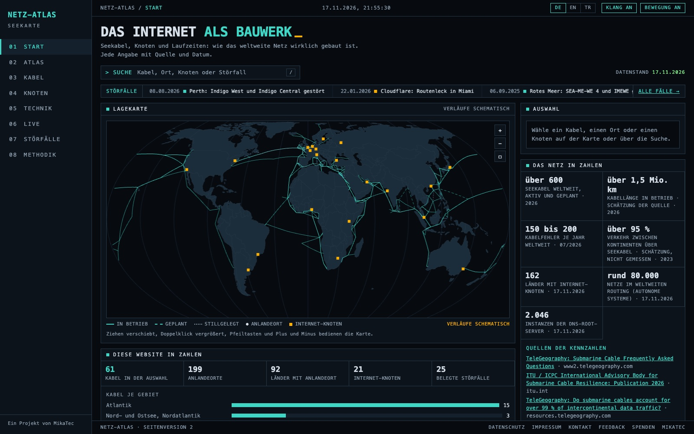

<table>
  <tr>
    <td width="50%" valign="top">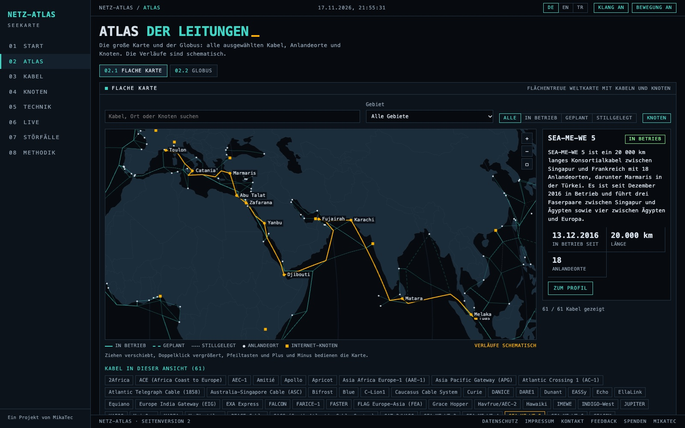<br><sub>Atlas: flächentreue Karte mit einem gewählten Kabel und seinen Anlandeorten</sub></td>
    <td width="50%" valign="top">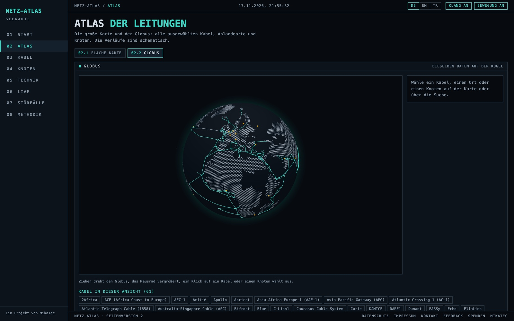<br><sub>Atlas: dieselben Kabel und Knoten auf dem Globus</sub></td>
  </tr>
  <tr>
    <td width="50%" valign="top">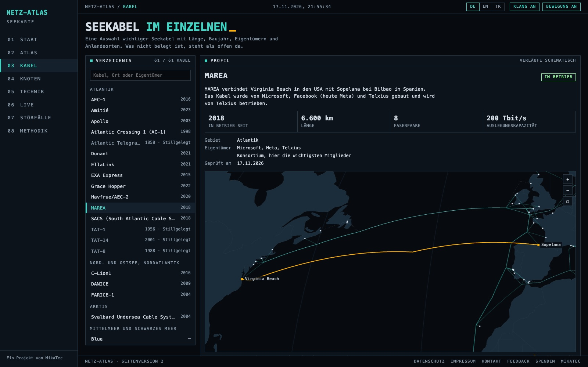<br><sub>Kabel: Verzeichnis links, Profil mit Stammdaten, Verlauf und Quellen rechts</sub></td>
    <td width="50%" valign="top">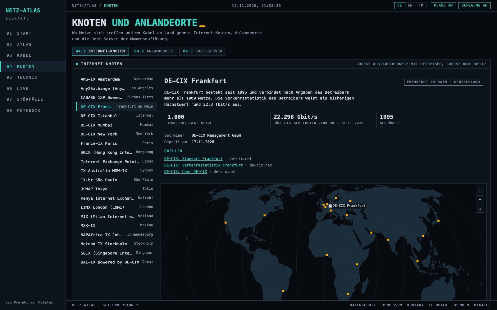<br><sub>Knoten: Internet-Knoten mit Betreiber, Größe, Stand und Quelle</sub></td>
  </tr>
  <tr>
    <td width="50%" valign="top">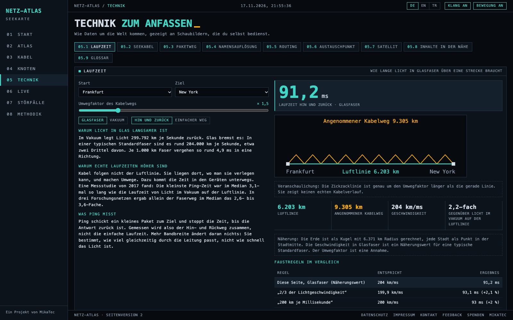<br><sub>Technik: wie lange Licht in Glasfaser über eine Strecke braucht</sub></td>
    <td width="50%" valign="top">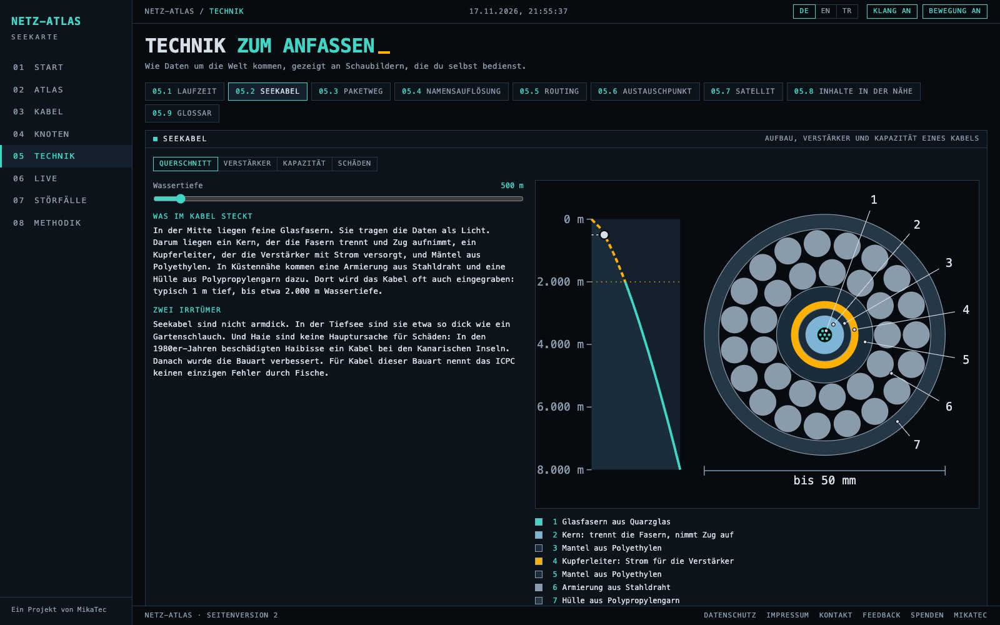<br><sub>Technik: Aufbau, Verstärker und Kapazität eines Seekabels</sub></td>
  </tr>
  <tr>
    <td width="50%" valign="top">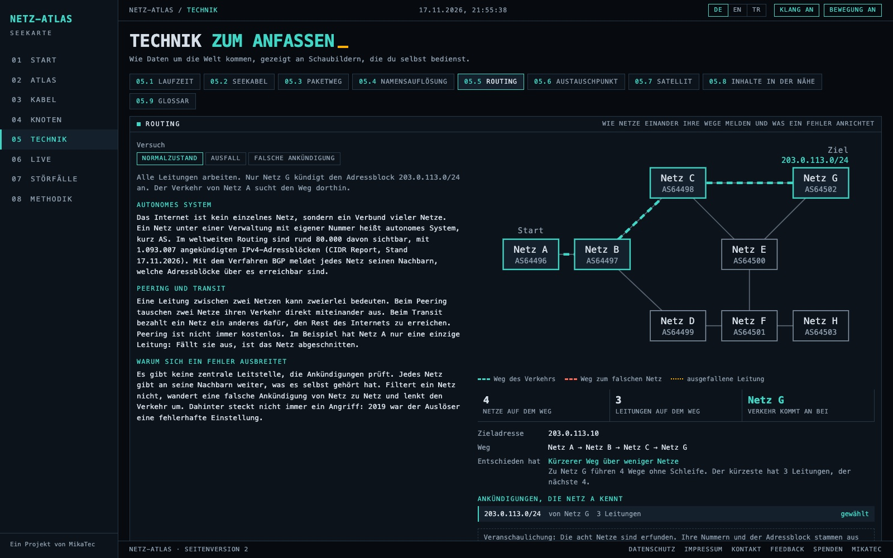<br><sub>Technik: wie Netze einander Wege melden und was ein Fehler anrichtet</sub></td>
    <td width="50%" valign="top">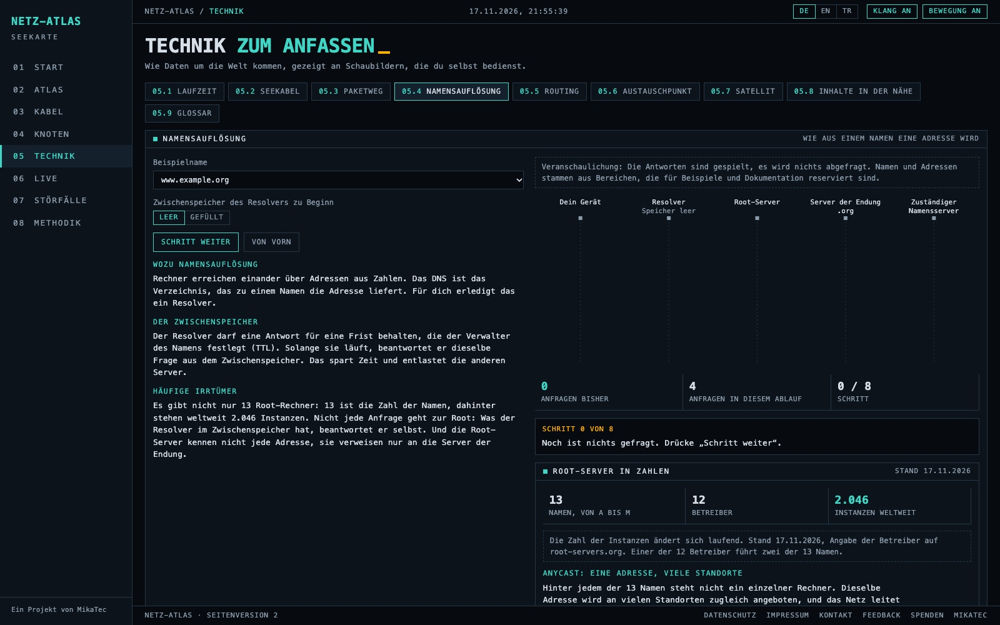<br><sub>Technik: wie aus einem Namen eine Adresse wird</sub></td>
  </tr>
  <tr>
    <td width="50%" valign="top">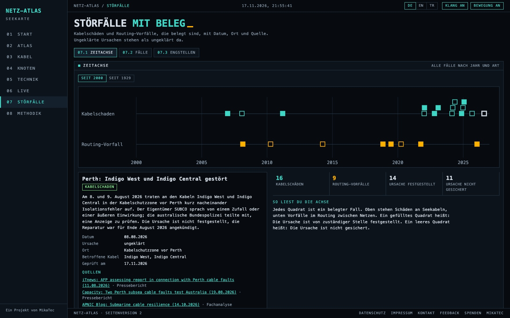<br><sub>Störfälle: belegte Kabelschäden und Routing-Vorfälle auf der Zeitachse</sub></td>
    <td width="50%" valign="top">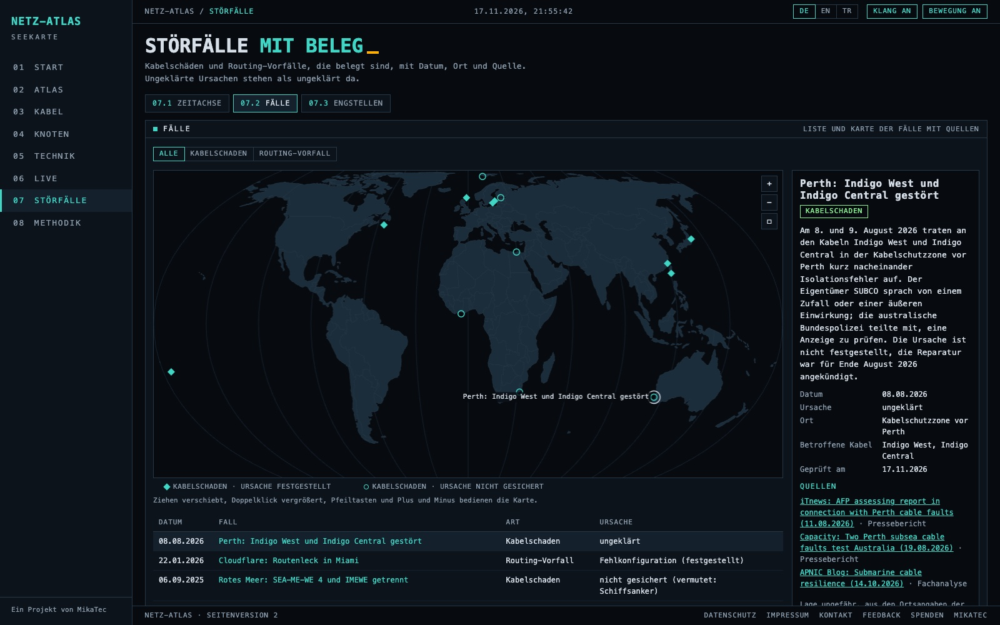<br><sub>Störfälle: Karte, Liste und Quellen je Fall</sub></td>
  </tr>
  <tr>
    <td width="50%" valign="top">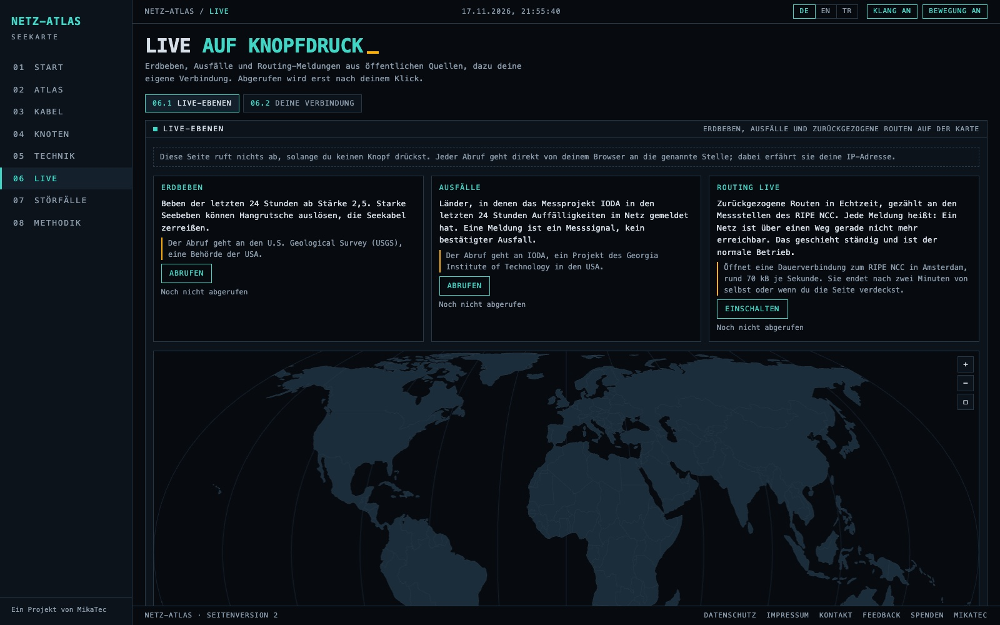<br><sub>Live: Erdbeben, Ausfälle und Routing, abgerufen erst nach einem Klick</sub></td>
    <td width="50%" valign="top">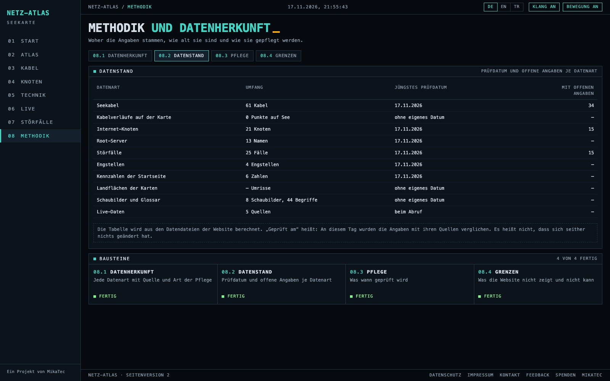<br><sub>Methodik: Umfang und Prüfdatum je Datenart</sub></td>
  </tr>
</table>

Die Bilder zeigen den Stand vom 17.11.2026.

## Die acht Bereiche

| Nr. | Bereich | Inhalt |
|---|---|---|
| 01 | Start | Lagekarte, Suche, Kennzahlen des Netzes mit Quelle, Meldungsband der jüngsten Störfälle |
| 02 | Atlas | flächentreue Weltkarte und Globus mit allen ausgewählten Kabeln, Anlandeorten und Knoten |
| 03 | Kabel | Verzeichnis mit Profil: Länge, Inbetriebnahme, Eigentümer, Anlandeorte, Quellen, offene Angaben |
| 04 | Knoten | Internet-Knoten, Anlandeorte und die Root-Server der Namensauflösung |
| 05 | Technik | acht bedienbare Schaubilder (Laufzeit, Seekabel, Paketweg, Namensauflösung, Routing, Austauschpunkt, Satellit, Inhalte in der Nähe) und ein Glossar |
| 06 | Live | Erdbeben, Ausfälle, Routing-Meldungen und die eigene Verbindung, jeweils erst nach Klick |
| 07 | Störfälle | belegte Kabelschäden und Routing-Vorfälle auf Zeitachse und Karte, dazu Engstellen |
| 08 | Methodik | Datenherkunft, Datenstand, Pflege, Grenzen |

Dazu kommt die Datenschutzseite `datenschutz.html`.

## Grundsätze

- **Quelle und Datum.** Jede Angabe nennt ihre Quelle und ihr Prüfdatum. Was sich nicht bestätigen
  ließ, steht als „nicht bestätigt“ da und wird nicht geschätzt.
- **Eine Auswahl, kein Vollständigkeitsanspruch.** Die Website zeigt eine von Hand gepflegte Auswahl
  wichtiger Seekabel und Knoten, nicht alle.
- **Schematisch bleibt schematisch.** Die Kabelverläufe verbinden die belegten Anlandeorte über ein
  eigenes Netz von Seewegen. Sie zeigen nicht, wo ein Kabel wirklich liegt; das steht an jeder Karte.
- **Näherung bleibt Näherung.** Was in den Schaubildern gerechnet oder vereinfacht ist, steht als
  Näherung oder Veranschaulichung da; jedes Schaubild nennt die Grenze seiner Darstellung.
- **Nichts ungefragt abrufen.** Beim Öffnen erhält nur der Webserver die IP-Adresse des Besuchers.
  Erdbeben, Ausfälle, Routing, Standort und Messung der Verbindung werden erst nach einem Klick
  abgerufen; am Knopf steht, an wen der Abruf geht. Keine Cookies, kein Besucherzähler, keine Werbung.
- **Ungeklärtes bleibt ungeklärt.** Bei Störfällen steht die Ursache nur dann als festgestellt da,
  wenn eine zuständige Stelle sie festgestellt hat.

## Daten

Die Daten liegen getrennt von der Darstellung in `daten/`:

| Datei | Inhalt | Herkunft |
|---|---|---|
| `kabel.js` | ausgewählte Seekabel mit Stammdaten, Anlandeorten und Quellen | von Hand, Seiten der Betreiber und Eigentümer, Behörden, Fachseiten |
| `knoten.js` | ausgewählte Internet-Knoten | von Hand, Seiten und Statistiken der Betreiber |
| `rootserver.js` | die 13 Root-Server mit Betreiber und Zahl der Instanzen | von Hand gezählt aus root-servers.org und der Liste der IANA |
| `vorfaelle.js` | belegte Kabelschäden und Routing-Vorfälle | von Hand, Betreiber, Behörden, Fachverbände, Fachanalysen, ergänzend Presse |
| `engstellen.js` | Meerengen mit besonders vielen Kabeln | von Hand, Berichte von ITU/ICPC und APNIC |
| `kennzahlen.js` | Kennzahlen der Startseite | von Hand, je Zahl eine genannte Quelle |
| `seewege.js` | Netz aus Punkten auf See für die schematischen Verläufe | eigene Arbeit |
| `land.js` | Landflächen der Karten | per Skript aus [Natural Earth](https://www.naturalearthdata.com/) (gemeinfrei) |
| `glossar.js`, `methodik.js`, `datenschutz.js` | Fachbegriffe, Beschreibung der Datenarten, Datenschutzhinweise | eigene Texte |

Übersetzbare Felder liegen als `{ de, en, tr }` vor; der deutsche Text ist die Vorlage. Umfang und
Prüfdatum jeder Datenart zeigt die Seite Methodik, berechnet aus den Datendateien. Die Datenbank von
TeleGeography wird nicht verwendet, weil sie nicht frei ist.

## Aufbau

```text
netz-atlas/
├── index.html, atlas.html, kabel.html, knoten.html, technik.html,
│   live.html, stoerfaelle.html, methodik.html      ← die acht Bereiche
├── datenschutz.html     ← Datenschutzhinweise
├── globus.html, flachkarte.html   ← Weiterleitungen der früheren Adressen auf den Atlas
├── css/seekarte.css     ← das Erscheinungsbild
├── js/                  ← Rahmen, Texte, Karte und je Seite eigene Skripte
├── daten/               ← die Datendateien
├── data/countries-110m.geojson   ← Geodaten von Natural Earth, Quelle für daten/land.js
├── vendor/              ← globe.gl für den Globus, lokal, mit Lizenztexten
├── werkzeuge/           ← Prüf- und Pflegeskripte
├── assets/ansichten/    ← Bildschirmfotos für dieses README
└── .nojekyll            ← GitHub Pages liefert die Dateien unverändert aus
```

- `js/bereiche.js` beschreibt die acht Bereiche mit ihren Bausteinen; `js/texte.js` und die Dateien
  `js/texte-….js` enthalten die Texte der Oberfläche in drei Sprachen.
- `js/rahmen.js` baut auf jeder Seite Leiste, Kopfzeile und Fußzeile und steuert Sprache, Klang und
  Bewegung. Navigation steht links, der Inhalt rechts; gescrollt wird nur im Inhalt.
- `js/karte.js` zeichnet die Weltkarte in der flächentreuen Projektion Equal Earth auf eine Leinwand
  und führt die Kabelverläufe über das Netz der Seewege.
- Der Globus nutzt die Bibliothek `globe.gl`, die lokal in `vendor/` liegt und erst geladen wird,
  wenn der Globus gezeigt wird. Sonst kommt die Website ohne fremde Bibliothek aus.
- Die Seiten binden klassische Skripte ein, keine Module, damit sie auch per `file://` laufen.
  Texte werden nie als HTML eingesetzt.
- Im Browser gespeichert werden nur drei Einstellungen: Sprache, Klang und Bewegung.

## Lokal ansehen

```bash
git clone https://github.com/Cehha79/netz-atlas.git
# index.html im Browser öffnen. Mehr ist nicht nötig.
```

## Prüfen und pflegen

Die Skripte helfen bei der Pflege. Sie brauchen [Node](https://nodejs.org) beziehungsweise Python 3,
die Website selbst braucht beides nicht.

| Befehl | Was er tut |
|---|---|
| `node werkzeuge/pruefen.js` | prüft Gerüst und Daten: drei Sprachen vollständig, Quellen und Datumsangaben vorhanden, Versionszähler auf allen Seiten gleich, benutzte Textschlüssel vorhanden |
| `node werkzeuge/links.js` | ruft jede Webadresse aus den Datendateien einmal ab und meldet tote Verweise |
| `python3 werkzeuge/land-bauen.py` | erzeugt `daten/land.js` aus den Geodaten von Natural Earth |

Nach jeder Änderung an einer Datei in `css/`, `js/` oder `daten/` wird deren `?v=` auf allen Seiten
hochgezählt, die sie einbinden; sonst zeigt der Browser den alten Stand. Der Prüfrhythmus steht auf
der Seite Methodik unter „Pflege“.

## Veröffentlichung

Auslieferung über **GitHub Pages** aus dem Hauptzweig. Die Website ist unter
[cehha79.github.io/netz-atlas](https://cehha79.github.io/netz-atlas/) erreichbar.

## Lizenzen und Rechte

Die Bibliothek `globe.gl` und ihre Bestandteile stehen unter den Lizenzen in
`vendor/LIZENZEN-globe.gl.txt`. Die Geodaten von Natural Earth sind gemeinfrei. Namen von Kabeln,
Betreibern und Knoten gehören den jeweiligen Inhabern.

---

Konzept und Umsetzung: © **MikaTec** · [www.mika-tec.com](https://www.mika-tec.com)
